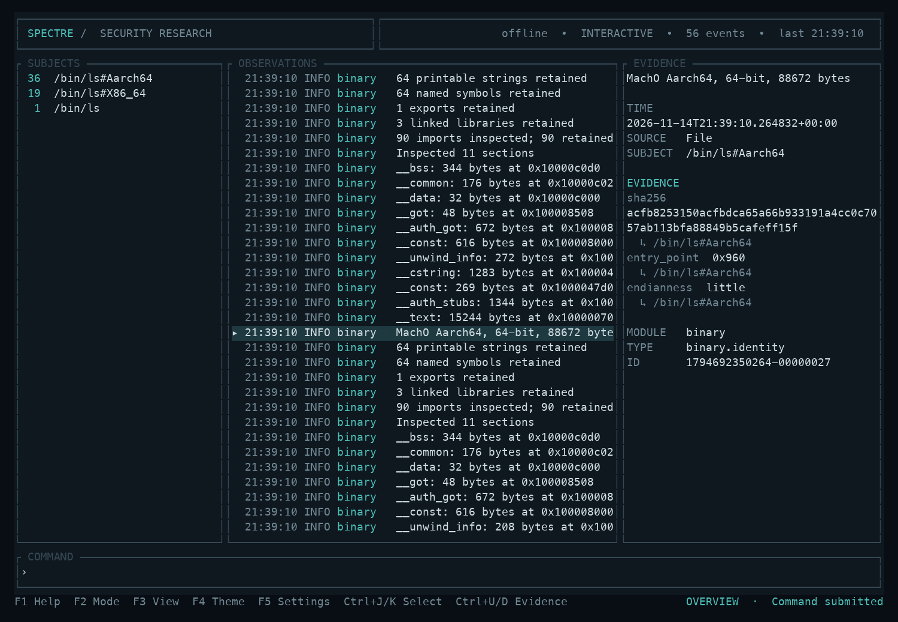

# SPECTRE

Terminal intelligence and security research environment

Created by Cade Masterson

SPECTRE brings local observations, offline artifact analysis, and explicitly scoped network assessment into one terminal workspace. Its event stream retains the evidence behind each observation. The current codebase is an early working foundation, with a focused set of analyzers and a shared interface for autonomous and hands-on work.

## What works today

| Area | Current capability |
| --- | --- |
| Local observation | Periodic host samples, process starts and inventory, per-interface traffic counters when enabled, and compact dossiers for observed executables when the binary module is enabled. |
| Process investigation | A live top-process snapshot by resident memory and inspection of a selected PID, including memory, status, timing, and executable path when available. |
| Binary analysis | PE, ELF, and Mach-O identity, SHA-256, sections and entropy, imports, linked libraries, exports, symbols, and bounded printable strings. |
| Packet analysis | Offline classic PCAP parsing, flow counts, DNS questions, TLS ClientHello SNI, and HTTP Host observations. |
| Network assessment | A real TCP survey of the selected private IPv4 interface's directly connected segment, capped at /24, with HTTP follow-up on observed open web ports. Exact-target scans have bounded concurrency and passive banner capture. |
| HTTP assessment | One scoped HTTP(S) response, including headers, cookie attributes, and HSTS observations. Redirects are not followed. |
| Indicator matching | User-configured SHA-256, domain, and IP values matched against supported observation fields, with source event references. |
| Investigation | A bounded event history, evidence inspection, subject links across modules, profile presets, and JSON Lines export. |
| Terminal workspace | Evidence-driven Mission, Network, Processes, Traffic, Binaries, and Timeline scenes in Assisted mode, plus host and binary dossier screens that appear as findings arrive; four themes and separate autonomous and interactive modes. |

SPECTRE does not yet include live packet capture, disassembly, runtime instrumentation, external threat intelligence, a plugin API, or binary releases. The [roadmap](docs/ROADMAP.md) tracks those directions separately from implemented behavior.

## Install and start

Use a current stable Rust toolchain on macOS, Linux, or Windows. From this repository:

```sh
cargo install --path . --locked
spectre doctor
spectre profiles
spectre
```

On macOS or Linux, if the shell reports `spectre: command not found` after installation, run `~/.cargo/bin/spectre` or add `~/.cargo/bin` to your `PATH`.

`spectre` opens the terminal workspace when standard input and output are attached to a terminal. On first launch it chooses a local profile from detected memory, then writes the configuration. Systems with at least 8 GiB of RAM start with `binary-monitor`; other systems use `local-research`. Both profiles inspect real executables from the local process baseline, including SPECTRE itself when available. `local-research` uses a smaller queue and one analysis slot; `binary-monitor` covers more paths with two slots. Each profile then watches its bounded set of executable paths for metadata changes. Local observation starts automatically. An explicit `spectre analyze binary PATH` request still returns the full detailed analysis.

The source build is the installation method at present. Precompiled packages and release installers have not been published. CI checks macOS, Linux, and Windows.

Use `spectre profiles`, `spectre themes`, `spectre modules`, and `spectre indicators` to inspect the current configuration. `spectre version` displays the installed version and creator attribution.

`spectre doctor` shows which local capabilities are available, including process inspection, interface counters, and the detected private LAN segment. It does not start a survey.

`spectre traffic snapshot` reads real cumulative byte totals for nonloopback interfaces. When the `traffic` module is enabled, SPECTRE also samples byte and packet counter changes during local collection. These counters describe aggregate traffic for an interface; they do not contain packet contents, destinations, or per-process attribution.

## A short investigation

Offline inspection needs no target scope:

```sh
spectre analyze binary /path/to/program
spectre analyze pcap /path/to/capture.pcap
```

For a current process snapshot, run:

```sh
spectre process top
spectre process inspect self
spectre process inspect 1234
```

Replace `1234` with a PID from `process top`. `self` selects the running SPECTRE process.

Add `--json` to a headless analysis command for complete JSON Lines output. The default text view limits long evidence lists for readability.

An exact indicator can be configured before analysis:

```sh
spectre indicators add domain example.org "research set"
spectre indicators
```

Matching is local and uses observed fields only. A match is a derived event that cites its source observation; it is not a malware verdict. Adding an indicator does not initiate a scan or expand target scope.

Network requests require an exact host or IP entry before they run:

```sh
spectre scope add 192.0.2.10
spectre scan 192.0.2.10 --ports 22,80,443
spectre investigate 192.0.2.10 --ports 22,80,443
spectre http http://192.0.2.10/
```

The addresses above are documentation examples. `scope add` records the target in the local configuration; it does not probe it. A scan uses only the ports supplied or the documented default set. `investigate` checks its selected ports and, when conventional web ports are open, makes bounded HTTP follow-ups pinned to the observed addresses. HTTP inspection makes one GET request and does not follow redirects.

To survey the current local network segment, run `spectre lan status` to see the selected interface and exact range, then `spectre lan survey` to make real TCP probes in that range. Open web ports can receive a bounded HTTP(S) follow-up. `spectre lan off` removes the LAN stages from the default session and disables the dedicated LAN survey; `spectre lan on` enables them again. Entering Assisted mode displays existing observations without starting a survey. Pressing `F6` on **System and network** or **Local network** starts a survey when LAN is enabled; ongoing follow-ups revisit the segment no more than once every 120 seconds while Assisted remains active. The survey reports hosts only when their TCP responses support that observation; a silent host may still be present.

Inside the workspace, press `/` for interactive command input and `F1` for the keyboard reference. `F2` cycles input modes while local collection continues. Assisted mode opens on the built-in **System and network** session and shows populated scenes from observations already collected. Press `F6` to run the whole sequence with one key: current host and process data, interface traffic, binary inspection, and a real local-network survey when enabled. No user-authored plan is needed. The combined run has 11 stages with LAN enabled and eight with it off. After that first pass, Assisted refreshes process and traffic results about every 20 seconds and, for the two LAN scenarios with LAN enabled, revisits the local segment no more than once every 120 seconds. Follow-ups pause when you leave Assisted. The scenes change as evidence arrives and continue cycling afterward. `F3` browses a scene and holds it for 30 seconds; Up/Down scrolls the scene and holds it; `F8` turns automatic scene changes on or off; `F7` pauses or resumes ongoing follow-ups after the first F6 run. Press `F5`, then `n`, to toggle only the LAN part. The `triage` command summarizes retained observation counts, recent subjects, indicator matches, correlation links, and latest observation IDs.

`Tab` selects focused local research, process investigation, local-network, or exact-target scenarios. For stage-by-stage use, passive review runs on Enter after a full reveal, and active network steps use `Ctrl+R`. An `F6` run performs the selected built-in session, including its active network steps. Custom prepared text can also be added, but it is only recorded, never executed. The scenes summarize observed data; they do not invent findings. See [usage](docs/USAGE.md) for controls and scope.

### Offline binary analysis session



Captured from the terminal workspace while inspecting `/bin/ls` with autonomous collection disabled. The [capture script](tools/capture_offline.py) reproduces the image from a PTY session on macOS.

## Design

Analyzers return structured events. An event has a timestamp, module, subject, severity, source type, and evidence entries with origins. A bounded hub stores recent events, links observations sharing a subject across modules, and broadcasts updates to the terminal workspace. The user interface displays analyzer output rather than generating technical findings.

[Architecture](docs/ARCHITECTURE.md) describes the data path, current boundaries, and extension work. [Contributing](CONTRIBUTING.md) covers development checks and evidence standards.

## Project status and licensing

SPECTRE is an early working foundation created and led by Cade Masterson. It is available under your choice of the [MIT](LICENSE-MIT) or [Apache-2.0](LICENSE-APACHE) license. Third-party dependencies retain their own license terms. The [roadmap](docs/ROADMAP.md#licensing-and-release) tracks the work remaining before a tagged release and packaged binaries.
